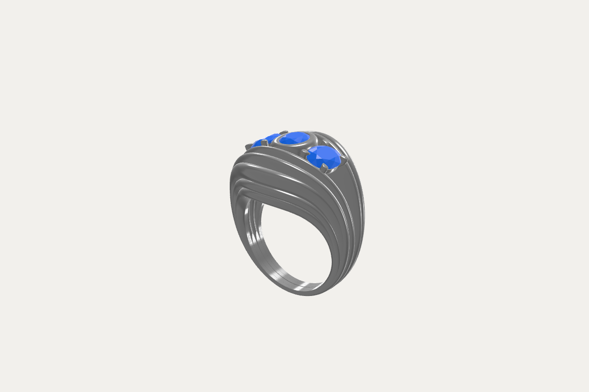

# Brief de développement — Configurateur 3D de bijoux (FBX → rendu temps réel → AR)

> **Destinataire : agent de développement (Claude Sonnet 5.5, Claude Code).**
> Ce document est ta source de vérité. Lis-le en entier avant d'écrire une ligne de code. Les sections marquées **[DÉCISION]** sont arrêtées ; celles marquées **[À VALIDER]** doivent être confirmées avec l'utilisateur (Mehdi) avant implémentation si elles bloquent.
>
> **Version 2 — changements majeurs :**
> - **iPhone (Safari ET Chrome iOS) devient la plateforme prioritaire** → nouvelle §2.4 « Contraintes iOS ».
> - **Essayage virtuel de la bague sur le doigt via la caméra** : passe de la roadmap au périmètre v1 → nouvelle §8.4.
> - **Fichier de test officiel fourni : `MAQUETTE_GEMV.fbx`** (analysé, voir nouvelle §3.3). Il sert de référence d'acceptation pour tous les jalons.
>
> Fichiers à placer dans le repo au démarrage :
> - `assets/test/MAQUETTE_GEMV.fbx` (fichier de test fourni par Mehdi — **ne pas commiter dans un repo public**, l'ajouter au `.gitignore` si le repo est public)
> - `docs/MAQUETTE_GEMV_reference.png` (rendu de référence de la bague, couleurs volontairement neutres)

---

## 0. Règles de travail pour l'agent

1. **Planifie avant de coder.** Produis d'abord `PLAN.md` (découpage en jalons de la §9, fichiers à créer, risques). Ne demande validation que pour les points [À VALIDER] bloquants ; pour le reste, décide et note ta décision dans `DECISIONS.md`.
2. **Ne devine jamais une API three.js.** Avant d'utiliser une classe/option, vérifie-la dans `node_modules/three/src` ou `node_modules/three/examples/jsm` de la version installée. Les API three.js changent entre révisions (r1xx) ; épingle la version exacte dans `package.json` (pas de `^`).
3. **Vérifie visuellement.** Chaque jalon se termine par des captures d'écran (Playwright) commitées dans `docs/screenshots/` et comparées à l'attendu. « Ça compile » n'est pas un critère de fin.
4. **Un commit par sous-tâche**, messages en français, format `feat(viewer): …`, `fix(materials): …`.
5. **Pas de backend en v1.** Tout se fait côté client ; le fichier FBX de l'utilisateur ne quitte jamais son navigateur (argument de confidentialité important pour un designer).
6. **Code commenté en français**, noms de variables/fonctions en anglais.
7. Si un choix technique de ce brief s'avère faux à l'usage (bug bloquant d'une lib, perf insuffisante), **tu as le droit de dévier** : documente pourquoi dans `DECISIONS.md` et propose l'alternative.

---

## 1. Vision produit

Une web app type **Sketchfab spécialisé bijouterie** : on dépose un fichier `.fbx` (bague, pendentif, boucle d'oreille…), il s'affiche en 3D interactive avec un rendu « photo produit » (métal qui brille, pierres qui scintillent). L'utilisateur **clique sur une partie** (anneau, griffes, chaton, pierre centrale, pavage…) et lui applique un **matériau depuis une palette de « billes »** (or jaune, or rose, platine, diamant, saphir, émeraude…). Le rendu change **en temps réel**. La configuration peut être **sauvegardée, partagée par lien, exportée**, **visualisée en réalité augmentée** sur mobile et **essayée virtuellement au doigt** grâce à la caméra du téléphone. **L'iPhone (Safari et Chrome) est la plateforme cible prioritaire.**

### Utilisateurs cibles (persona)

| Rôle | Qui | Ce qu'il veut | Ce qui le fait fuir |
|---|---|---|---|
| **Designer / joaillier** | Créateur CAO (Rhino/Matrix/Blender), atelier, marque | Importer son modèle tel quel, nommer les zones, composer des variantes, montrer au client, exporter des visuels | Un import qui casse l'échelle/l'orientation, des zones mal découpées sans moyen de corriger, un rendu « plastique » |
| **Acheteur / client final** | Particulier qui personnalise une bague (fiançailles, cadeau) | Essayer des combinaisons simplement, voir un rendu crédible, se projeter (AR, taille réelle), partager avec un proche, avoir une idée du prix | Le jargon technique (mesh, material slot), une UI chargée, un rendu lent sur mobile |
| **Vendeur en boutique** *(rôle déduit)* | Conseiller sur tablette face au client | Basculer vite entre variantes, comparer côte à côte, envoyer la config au client | Des manipulations longues, l'absence de mode « présentation » |

> **Conséquence de design [DÉCISION] :** deux modes d'interface dans la même app.
> - **Mode Atelier** (designer) : import, découpage/nommage des zones, gestion de la bibliothèque de matériaux, règles.
> - **Mode Vitrine** (acheteur/vendeur) : uniquement visualiser, choisir des matériaux autorisés par zone, partager, AR. Aucun terme technique visible.
> Une config préparée en mode Atelier s'exporte en un « projet » (`.json` + modèle) qui s'ouvre directement en mode Vitrine.

---

## 2. Stack technique

### 2.1 Choix [DÉCISION]

| Besoin | Choix | Pourquoi |
|---|---|---|
| Build / dev server | **Vite** (dernière stable) | Standard, ES modules natifs, rapide |
| Langage | **JavaScript ES2022 + JSDoc typé** (TypeScript accepté si tu le juges plus sûr — note-le dans DECISIONS.md) | Demande initiale : HTML5/CSS3/JS |
| Moteur 3D | **three.js**, dernière révision stable au moment du démarrage, **épinglée** | Écosystème de loin le plus large du web 3D, loaders FBX/GLTF, exporters GLB/USDZ officiels |
| Renderer | **WebGLRenderer (WebGL2) par défaut** ; WebGPURenderer en option expérimentale derrière un flag | Le renderer WebGPU est prêt pour la plupart des usages mais les shaders de pierres (réfraction) et certains addons (post-process, pathtracer) sont plus matures côté WebGL. Ne pas mélanger les imports `three` et `three/webgpu`. |
| Import FBX | `FBXLoader` (three/examples/jsm) | Officiel |
| Accélération picking | **three-mesh-bvh** | Raycast rapide sur modèles lourds (pavages de centaines de pierres) ; sert aussi au shader de réfraction diamant |
| Contrôles caméra | `OrbitControls` (damping activé) | Comportement « Sketchfab » |
| Environnement / éclairage | HDRI studio (`RGBELoader` ou `HDRLoader` selon la révision + `PMREMGenerator`), fallback `RoomEnvironment` | La bijouterie est un rendu de **reflets** : l'environnement fait 80 % du résultat |
| Post-process | `EffectComposer` + `OutputPass`, bloom très léger (`UnrealBloomPass`), `OutlinePass` pour la sélection, SMAA/FXAA | Scintillement et lisibilité de la sélection |
| Rendu haute qualité (option) | **three-gpu-pathtracer** pour un mode « Photo HD » (rendu progressif à l'arrêt) | Qualité catalogue pour export d'images ; à intégrer en jalon tardif |
| AR | **`<model-viewer>`** (Google) utilisé **uniquement comme lanceur AR**, alimenté par un GLB exporté à la volée (`GLTFExporter`) + USDZ pour iOS (`USDZExporter`) | Gère WebXR, Scene Viewer (Android) et Quick Look (iOS) avec une seule balise |
| UI | HTML/CSS natif + Web Components légers (ou lit-html si besoin) ; **pas de React** sauf justification | Demande initiale ; app mono-écran |
| État | Store maison minimal (pub/sub) + historique undo/redo | Simplicité |
| Tests | **Vitest** (logique), **Playwright** (E2E + captures visuelles) | Vérification visuelle obligatoire |

### 2.2 Alternatives écartées (pour info, ne pas réévaluer sauf blocage)
- **Babylon.js** : très bon (inspector, PBR), mais communauté/exemples bijouterie moindres et ecosystème loaders/exporters USDZ moins direct.
- **model-viewer seul** : excellent pour l'AR et l'affichage simple, mais ne lit pas le FBX, picking par sous-partie limité, pas de shader pierre avancé. → utilisé seulement pour l'AR.
- **React Three Fiber + drei** : drei fournit `MeshRefractionMaterial` (diamant) clé en main, tentant ; écarté pour rester en JS natif. **Mais** : tu peux t'inspirer de son code source (licence MIT) pour porter le shader de réfraction en vanilla.
- **PlayCanvas** : orienté éditeur cloud, moins adapté.

### 2.3 Skills à installer au démarrage

Installe **un** paquet de skills three.js pour Claude Code, lis les SKILL.md pertinents, et **en cas de conflit avec la doc/le code source de la version épinglée, le code source gagne**.

Option recommandée (couvre loaders, matériaux, post-process, WebGPU, **XR**) :
```bash
git submodule add https://github.com/OpenAEC-Foundation/Three.js-Claude-Skill-Package.git .claude/skills/threejs
```
Alternative plus légère :
```bash
git clone https://github.com/CloudAI-X/threejs-skills.git /tmp/threejs-skills && cp -r /tmp/threejs-skills/.claude/skills/* .claude/skills/
```
Ignorer les paquets orientés « jeux » (non pertinents ici). Outillage recommandé en plus : serveur MCP **Playwright** pour piloter le navigateur et faire les captures.

> Si l'install d'un repo échoue (repo renommé/supprimé), cherche l'équivalent actuel, note-le dans DECISIONS.md, ne bloque pas le projet pour ça.

Librairies supplémentaires (v2) :

| Besoin | Choix | Notes |
|---|---|---|
| Suivi de la main | **`@mediapipe/tasks-vision`** → `HandLandmarker` (Apache 2.0) | 21 points par main en 2D + coordonnées « monde » en mètres ; tourne en WASM + WebGL dans Safari iOS. **Héberger localement** le `.wasm` et le modèle `hand_landmarker.task` (pas de dépendance CDN à l'exécution). |
| Alternative suivi de la main | WebAR.rocks.hand | Démos de bague déjà faites, mais **licence GPLv3** → incompatible avec un usage commercial fermé sans licence payante. Ne pas l'utiliser ; s'en inspirer conceptuellement uniquement. |
| Lissage du tracking | Filtre **One Euro** (implémentation maison, ~40 lignes) | Supprime le tremblement sans latence visible |
| Simplification de maillage (LOD) | **meshoptimizer** (`meshoptimizer` npm, `MeshoptSimplifier`) | Le modèle de test fait 378 k triangles : il faut un LOD allégé (~60–80 k) pour l'essayage sur la main sur iPhone |
| Débogage sur iPhone sans Mac | **eruda** (console in-page, chargée seulement en `?debug=1`) | Mehdi travaille sur PC Windows : pas de Web Inspector Safari |

### 2.4 Contraintes iOS (plateforme prioritaire) [DÉCISION]

**Fait structurant : sur iPhone, Chrome, Firefox, Edge… utilisent tous le moteur WebKit de Safari.** Tester Chrome iOS ne remplace pas Safari et inversement : les deux doivent être testés, mais ils ont les mêmes capacités et les mêmes limites.

| Sujet | Contrainte iOS | Ce que tu dois faire |
|---|---|---|
| **WebXR** | Pas de session `immersive-ar` WebXR sur iPhone, ni dans Safari ni dans Chrome iOS. | **Ne jamais dépendre de WebXR sur iOS.** AR « posée sur une surface » = **AR Quick Look** (USDZ). Essayage sur la main = **caméra + tracking + three.js** (§8.4), pas de WebXR. Garder une détection `navigator.xr?.isSessionSupported('immersive-ar')` pour Android et pour le jour où Apple l'activera. |
| AR Quick Look | Fonctionne dans Safari via `<a rel="ar" href="x.usdz"></a>` ou `<model-viewer ar-modes="quick-look">`. Comportement dans Chrome iOS **à vérifier sur appareil**. | Tester les deux. Si Quick Look ne s'ouvre pas dans Chrome iOS : afficher « Ouvrir dans Safari pour l'AR » avec bouton copier le lien. |
| Caméra (`getUserMedia`) | HTTPS obligatoire ; démarrage sur geste utilisateur ; vidéo avec `playsinline muted autoplay` sinon plein écran natif / écran noir ; permission redemandée selon les réglages Safari. | Bouton explicite « Essayer sur ma main » ; écran d'explication avant la demande de permission ; gestion propre du refus (message + bouton réessayer). |
| Sélecteur de fichier | iOS ne connaît pas le type `.fbx` : `accept=".fbx"` **grise le fichier** dans l'app Fichiers. | Ne pas mettre d'`accept` restrictif (ou `accept="*/*"`) et valider l'extension + l'en-tête (`Kaydara FBX Binary`) en JS. |
| Mémoire | Safari tue l'onglet au-delà d'environ 1–1,5 Go (variable selon le modèle d'iPhone). | Pas de textures > 2048 px sur mobile ; `dispose()` strict ; un seul renderer WebGL partagé (ne pas créer un 2ᵉ contexte pour les billes : rendre les vignettes avec le renderer principal dans un render target) ; LOD allégé en mode essayage. |
| Plein écran | L'API Fullscreen n'est pas disponible pour un élément sur iPhone. | « Pseudo plein écran » CSS + manifeste PWA (`display: standalone`) pour « Ajouter à l'écran d'accueil ». |
| Viewport | `100vh` faux avec les barres Safari ; encoche. | `100dvh`, `env(safe-area-inset-*)`, `viewport-fit=cover`. |
| Gestes | Safari intercepte le pinch pour zoomer la page. | `touch-action: none` sur le canvas, `preventDefault` sur `gesturestart`/`gesturechange`. |
| Rendu | WebGL2 disponible ; `transmission` coûte un rendu supplémentaire. | Mode qualité « Mobile » par défaut sur iOS (pixel ratio ≤ 2, bloom désactivé, pierres en matériau standard §5.2 niveau 1). WebGPU : ne pas l'utiliser sur iOS en v1. |
| Partage | Web Share API (avec fichiers) disponible. | Partage de la capture d'essayage via `navigator.share({ files })`, repli sur téléchargement. |
| Encodage | Les noms FBX contiennent des accents (`Métal`, `Défaut`, `Matériau_11`). | `<meta charset="utf-8">` ; normaliser tous les noms en `String.normalize('NFC')` avant comparaison. |

**Appareil de référence de Mehdi : iPhone 17 Pro Max (512 Go), iOS à jour.** C'est un appareil haut de gamme récent : il valide la faisabilité mais **ne représente pas le parc d'acheteurs**.
- Les objectifs de fps (§8.4, §10) doivent être tenus sur cet appareil **et** vérifiés avec un profil bridé : réduire artificiellement la charge (pixel ratio 2, LOD) et viser ≥ 24 fps sur un iPhone de 3 ans. Ne pas valider la performance uniquement sur le 17 Pro Max.
- Il dispose de plusieurs caméras arrière : l'essayage doit utiliser la caméra **principale (grand-angle)** et non l'ultra grand-angle. Choisir explicitement via `getUserMedia` (`facingMode: 'environment'` puis liste `enumerateDevices`) et **mesurer le FOV réel** plutôt que de supposer 60–65° : l'exposer comme réglage de calibration.
- Consigner dans `docs/IOS_TESTS.md` : modèle, version exacte d'iOS, Safari ou Chrome iOS, et résultat.

**Environnement de test iOS obligatoire :**
- Serveur de dev accessible en **HTTPS sur le réseau local** (`vite --host` + certificat local type mkcert, ou tunnel HTTPS) pour tester sur l'iPhone de Mehdi.
- Projet Playwright **WebKit + émulation iPhone** dans la CI pour les tests de non-régression (l'émulation ne remplace pas le vrai appareil, surtout pour la caméra et Quick Look).
- `docs/IOS_TESTS.md` : tableau par jalon (Safari / Chrome iOS × fonctionnalité × OK/KO × modèle d'iPhone × version iOS).

---

## 3. Pipeline d'import FBX (le point le plus risqué)

Les FBX de bijouterie viennent de logiciels très différents. L'import doit être **robuste et réparable**.

### 3.1 Étapes à implémenter
1. **Drag & drop + bouton « Ouvrir »** ; accepter `.fbx` (et aussi `.glb/.gltf/.obj` en bonus — le pipeline aval est identique).
2. **Chargement avec progression** (barre %) ; erreur lisible si fichier invalide/ASCII FBX ancien non supporté.
3. **Normalisation :**
   - **Unités** : FBX souvent en cm ou mm. Calculer la bounding box ; afficher la taille détectée (ex. « 21,4 mm ») et proposer de corriger l'unité (mm/cm/m/inch) en mode Atelier. Une bague doit mesurer ~15–25 mm de diamètre extérieur. Stocker l'échelle réelle : elle sert pour l'AR « taille réelle ».
   - **Axe vertical** : détecter Z-up vs Y-up ; bouton « pivoter 90° » en mode Atelier.
   - **Centrage** sur l'origine + cadrage caméra automatique (fit to bounding sphere).
   - **Normales** : recalculer si absentes ; option « lisser / facettes » (les pierres DOIVENT rester en facettes, ne jamais lisser leurs normales).
4. **Conversion des matériaux d'origine** (souvent `MeshPhongMaterial`/`MeshLambertMaterial`) en `MeshPhysicalMaterial` PBR, en conservant couleur et textures s'il y en a.
5. **Découpage en zones sélectionnables** (voir §4) : attention aux **meshes multi-matériaux** (un seul mesh avec plusieurs groupes de matériaux) → la sélection se fait **par groupe de matériau**, pas seulement par mesh.
6. **Détection automatique du type de zone** (métal / pierre) — heuristiques combinées, avec score :
   - nom du mesh ou du matériau (`stone|gem|diamond|diam|brill|pierre|saphir|ruby|emerald|cz|zircon` → pierre ; `metal|gold|or|silver|argent|band|ring|anneau|prong|griffe|shank|bezel` → métal) ;
   - géométrie : objet petit, nombreux duplicats identiques, normales à facettes planes → pierre ;
   - le designer peut **toujours corriger** à la main.
7. **Instanciation** : si 50+ pierres identiques (pavage), les fusionner en `InstancedMesh` pour la perf, en gardant la sélection individuelle possible (via `instanceId`).

### 3.2 Modèles de test
- **Fichier de référence : `MAQUETTE_GEMV.fbx`** (fourni, analysé en §3.3). C'est le modèle chargé par défaut au démarrage en développement.
- En complément, **construis en code une bague de démo procédurale** (anneau via `TorusGeometry`/`LatheGeometry`, 4 griffes, une pierre taille brillant approximée par une géométrie facettée, un pavage de petites pierres), **exporte-la en GLB** comme asset de démo, et charge-la au démarrage si aucun fichier n'est fourni. L'app ne doit jamais s'ouvrir sur un écran vide.
- Récupère aussi 2–3 modèles libres de droits (bagues/bijoux CC0/CC-BY) pour tester des topologies variées ; documente leur licence dans `assets/LICENSES.md`.

### 3.3 Analyse du fichier de test `MAQUETTE_GEMV.fbx`

Analyse faite avec `FBXLoader` de three r180 (chargement OK, sans erreur bloquante). **Ces constats sont des critères d'acceptation : ton import doit les gérer automatiquement.**

**Format et repère**
| Propriété | Valeur | Conséquence |
|---|---|---|
| Format | FBX **binaire 7.7** (en-tête `Kaydara FBX Binary`, version 7700), exporté via FBX SDK 2020.3.2 | Supporté par FBXLoader |
| Logiciel d'origine | Calques nommés `V3` et `Défaut` → très probablement **Rhino (version française)** | Les autres fichiers du designer auront la même structure |
| Unités | `UnitScaleFactor = 0.1` → **1 unité = 1 mm** | Afficher les dimensions en mm ; échelle AR : ×0.001 pour passer en mètres |
| Axe vertical | **Z-up** (les pierres sont en +Z, les caméras « Dessus » en Z=+80) | Pivoter de −90° autour de X pour passer en Y-up (convention three.js/glTF) **avant** tout export GLB/USDZ |
| Axe du doigt | **Axe Y du fichier** (le trou de la bague est traversé par Y) | Indispensable pour l'essayage sur la main (§8.4) : après passage en Y-up, l'axe du doigt devient l'axe −Z/+Z du modèle — calcule-le et stocke-le dans les métadonnées du modèle |
| Dimensions hors-tout | 26,1 × 19,6 × 29,6 mm (X × Y × Z) | Cohérent avec une bague volumineuse type « dôme » |
| Diamètre intérieur | **≈ 19,5 mm** (mesuré : 19,49 mm, taille FR 61) | À **mesurer précisément** à l'import (lancer de rayons radiaux depuis l'axe du doigt, avec BVH sinon trop lent) et à afficher : « Diamètre intérieur 18,1 mm — taille 57 » |
| Caméras incluses | `Perspective` + 3 orthographiques `Dessus`, `Face`, `Droite` (FBXLoader ne gère pas les orthographiques et émet un avertissement) | Lire leurs positions et **en faire les vues prédéfinies** (« Dessus / Face / Droite ») : c'est le cadrage voulu par le designer |
| Géométrie | Non indexée (sommets = 3 × triangles), normales présentes ; UV présentes sur les métaux, **absentes sur les pierres et les griffes** | `mergeVertices` (avec tolérance faible) pour réduire la mémoire et accélérer le BVH, **sans** relisser les normales des pierres ; la finition « martelé » (normalMap) doit gérer l'absence d'UV (triplanaire ou génération d'UV) |
| Total | **27 meshes, 378 556 triangles**, 3 matériaux | Lourd pour l'essayage mobile → LOD (§8.4) |

**Composition (ce que doit reconnaître la détection de zones)**



C'est une **bague trilogie** : 3 pierres ovales sur un corps « dôme » à godrons (fils parallèles).

| Zone attendue (nom client) | Objets | Matériau d'origine | Remarques |
|---|---|---|---|
| Pierre centrale | `Objet_2` | `Diamond` | Ovale ≈ 4,5 × 6,4 mm, 176 triangles (taille facettée simplifiée) |
| Pierres latérales | `Objet_7`, `Objet_9` | `Diamond` | Ovales ≈ 4,9 × 7,1 et 4,5 × 7,0 mm |
| Chaton central (clos) | `Objet_1` | `Métal` | Serti clos autour de la pierre centrale |
| Paniers latéraux | `Objet_8`, `Objet_10` | `Métal` / **`Matériau_11`** | `Objet_10` a un matériau différent de son jumeau `Objet_8` : probablement une erreur de la CAO. La détection doit le classer en **métal** quand même (géométrie et voisinage), et le regroupement par symétrie doit les associer |
| Griffes | `Objet_3, 4, 5, 6, 12, 13, 14, 15` | `Métal` | 8 griffes identiques (1 810 triangles chacune), 4 par pierre latérale → bon cas pour « sélectionner les similaires » |
| Corps à godrons | `Objet_16` à `Objet_28` | `Métal` | 13 fils formant le dôme. Doivent pouvoir être sélectionnés **ensemble** (« Corps ») **ou individuellement** (bicolore : un fil sur deux en or rose, par exemple, effet très recherché en joaillerie) |

**⚠️ Doublons superposés à détecter :** `Objet_19` est une copie exacte de `Objet_18`, `Objet_20` de `Objet_16`, `Objet_21` de `Objet_17` (même nombre de sommets, même boîte englobante, même centre). Conséquences : scintillement de surface (z-fighting) quand les deux ont des matériaux différents, double clic nécessaire, triangles inutiles.
→ À l'import : **détecter les meshes identiques et superposés** (empreinte : nombre de sommets + boîte englobante + hash d'un échantillon de positions), les masquer/supprimer par défaut et le signaler au designer : « 3 pièces en double ont été ignorées ». Prévoir une option pour les garder.

**Résultat attendu après import (test automatisé) :** 24 pièces utiles, 6 zones proposées automatiquement (pierre centrale, pierres latérales, chaton, paniers, griffes, corps), axe Y-up, bague centrée, vue « Face » disponible, diamètre intérieur affiché ≈ 19,5 mm (taille FR 61).

---

## 4. Sélection des parties

| Fonction | Détail |
|---|---|
| Survol | Contour léger (OutlinePass) + nom de la zone en infobulle |
| Clic | Sélectionne la zone ; contour plus marqué ; le panneau matériaux s'adapte au **type** de zone (métaux pour une zone métal, pierres pour une zone pierre) |
| Multi-sélection | `Shift+clic` ; en tactile : mode « multi » via un bouton |
| « Sélectionner les similaires » | Toutes les pierres de même géométrie/matériau (indispensable pour un pavage de 80 pierres) |
| Liste des zones | Panneau latéral arborescent (mode Atelier) / liste simplifiée avec vignettes (mode Vitrine) ; clic dans la liste = sélection dans la 3D |
| Isoler / masquer | Mode Atelier : masquer une zone pour atteindre une pièce cachée (ex. galerie sous le chaton) |
| Focus | Double-clic sur une zone = la caméra s'anime vers elle |
| Regroupement manuel | Mode Atelier : fusionner plusieurs meshes en une zone nommée (« Griffes ») ou scinder |
| Nommage | Mode Atelier : renommer les zones avec des noms clients (« Anneau », « Pierre centrale », « Pavage épaule gauche ») |
| Échap / clic dans le vide | Désélectionne |

---

## 5. Bibliothèque de matériaux (« billes »)

Chaque matériau s'affiche comme une **bille sphérique pré-rendue** (vignette générée au démarrage par un mini-renderer offscreen, mise en cache) avec son nom. Clic = application immédiate à la sélection, avec transition douce (~200 ms d'interpolation couleur/rugosité).

### 5.1 Métaux (valeurs PBR physiquement plausibles, metalness = 1)

Couleurs de base en **linéaire** (valeurs de réflectance F0 usuelles) — à ajuster visuellement sous l'HDRI retenu :

| Matériau | baseColor (linéaire RGB) | Notes |
|---|---|---|
| Or jaune 18 k | (1.000, 0.766, 0.336) | Référence or |
| Or jaune 24 k | (1.000, 0.710, 0.290) | Plus saturé |
| Or rose 18 k | (0.950, 0.640, 0.540) | Cuivré |
| Or blanc (rhodié) | (0.900, 0.890, 0.870) | Quasi argent froid |
| Platine | (0.672, 0.637, 0.585) | Plus sombre et gris que l'argent |
| Argent 925 | (0.972, 0.960, 0.915) | Le plus clair |
| Palladium | (0.733, 0.697, 0.652) | |
| Titane | (0.542, 0.497, 0.449) | |
| Noir (rhodium noir / PVD) | (0.05, 0.05, 0.05), metalness 1, rugosité 0.25 | Tendance |

**Finitions** (indépendantes du métal — deuxième rangée de choix) :

| Finition | Paramètres |
|---|---|
| Poli miroir | roughness 0.03–0.06 |
| Satiné / brossé | roughness 0.30 + `anisotropy` 0.8 (MeshPhysicalMaterial le supporte) |
| Sablé / mat | roughness 0.55 |
| Martelé | roughness 0.08 + normalMap martelage (générer une texture procédurale ou CC0) |

> Le métal et la finition sont **deux choix séparés** (un acheteur pense « or rose » puis « satiné »). C'est un point d'UX validé en se plaçant côté acheteur.

### 5.2 Pierres (MeshPhysicalMaterial, transmission = 1, metalness = 0, roughness ≈ 0)

| Pierre | IOR | Dispersion* | Couleur d'atténuation |
|---|---|---|---|
| Diamant | 2.42 | forte (~0.044 → régler `dispersion` visuellement) | incolore |
| Moissanite | 2.65 | très forte | incolore légèrement chaud |
| Zircon / oxyde de zirconium | 2.15 | forte | incolore |
| Saphir bleu | 1.77 | faible | bleu profond |
| Saphir rose / jaune | 1.77 | faible | rose / jaune |
| Rubis | 1.77 | faible | rouge sang |
| Émeraude | 1.58 | faible | vert, légèrement « jardinée » (option : légère rugosité/inclusions) |
| Améthyste | 1.54 | faible | violet |
| Topaze bleue | 1.62 | faible | bleu ciel |
| Aigue-marine | 1.58 | faible | bleu pâle |
| Citrine | 1.54 | faible | jaune-orangé |
| Tsavorite / péridot | 1.74 / 1.67 | faible | vert vif / vert-jaune |
| Pierres opaques (option) : onyx, nacre, turquoise, lapis | — | — | matériaux non transmissifs (couleur + roughness, nacre avec `iridescence`) |

\* La propriété `dispersion` de MeshPhysicalMaterial existe dans les révisions récentes : vérifie-la dans la version installée.

**Deux niveaux de qualité pour les pierres [DÉCISION] :**
1. **Standard (mobile, défaut)** : MeshPhysicalMaterial transmission + ior + dispersion + attenuation.
2. **Haute qualité (desktop)** : shader de réfraction par lancer de rayons dans la géométrie de la pierre (technique `MeshRefractionMaterial`, basée sur three-mesh-bvh + cubemap d'environnement) → rebonds internes, feu, scintillement réalistes. Porter le principe en vanilla. Bascule auto selon GPU (détection perf au premier rendu) + réglage manuel.

### 5.3 Bibliothèque éditable (mode Atelier)
- Créer/dupliquer/modifier un matériau (sliders couleur, rugosité, IOR…) avec aperçu bille live.
- Importer/exporter la bibliothèque en JSON.
- **Règles par zone** : le designer coche quels matériaux sont autorisés pour chaque zone en mode Vitrine (ex. la pierre centrale n'accepte que diamant/saphir/rubis/émeraude ; l'anneau n'accepte que les ors et le platine). Empêche les combinaisons impossibles côté fabrication.

---

## 6. Visionneuse « Sketchfab »

| Fonction | Détail |
|---|---|
| Orbite / zoom / pan | Souris, trackpad, tactile (pinch, 2 doigts) ; damping ; limites de zoom adaptées à la taille de l'objet |
| Auto-rotation | Lente, s'arrête à l'interaction, reprend après X s d'inactivité (mode Vitrine) |
| Environnements | 3–5 HDRI studio sélectionnables (CC0, ex. Poly Haven), rotation de l'environnement (les reflets bougent : essentiel en bijouterie), intensité |
| Fond | Couleur unie, dégradé, transparent (pour capture), ou HDRI flou |
| Sol | Ombre de contact douce (ContactShadows-like) + reflet sol optionnel |
| Tone mapping | Par défaut **Neutral (Khronos PBR Neutral)** pour respecter les couleurs des matériaux ; options AgX / ACES ; exposition réglable |
| Vues prédéfinies | Face, profil, dessus, 3/4 « catalogue » ; boutons rapides |
| Plein écran | Oui |
| Mode présentation | Masque toute l'UI sauf les billes (usage boutique/tablette) |
| Annotations (option) | Points d'info sur le modèle (« Griffes en platine pour la solidité ») posés par le designer |
| Mode Photo HD | Rendu path tracing progressif à l'arrêt + export PNG jusqu'à 4K, fond transparent possible |
| Comparateur | Écran scindé ou côte à côte : 2–4 variantes de la même bague, caméras synchronisées |

---

## 7. Sauvegarde, partage, export

| Fonction | Détail |
|---|---|
| Undo / Redo | `Ctrl+Z` / `Ctrl+Shift+Z`, historique de 50 actions |
| État de configuration | JSON : `{ modelId, zones: { zoneId: { materialId, finishId } }, env, camera }` |
| Lien de partage | Config encodée dans le hash de l'URL (compressée, ex. lz-string) → ouvre la même config. ⚠️ Le modèle lui-même n'est pas dans l'URL en v1 (pas de backend) : le lien fonctionne pour les modèles de démo/catalogue hébergés ; pour un FBX local, exporter un projet. |
| Projet | Export/import d'un fichier `.json` (+ GLB du modèle normalisé) = tout ce qu'il faut pour rouvrir en mode Vitrine |
| Variantes | Enregistrer plusieurs configs nommées (« Version or rose saphir ») dans le projet ; localStorage pour la session (try/catch) |
| Capture | PNG de la vue courante (résolution ×2), et planche des variantes |
| Export 3D | GLB de la configuration (GLTFExporter) ; USDZ (USDZExporter) |
| Fiche récap (acheteur) | Résumé lisible : liste zone → matériau, vignette, prix indicatif si activé ; export PDF via impression navigateur |

---

## 8. Réalité augmentée

### 8.1 Implémentation [DÉCISION]
1. À l'appui sur « Voir en AR », exporter la configuration courante en **GLB** (Android/WebXR) et en **USDZ** (iOS) côté client (Blob URLs).
2. Injecter ces blobs dans un élément `<model-viewer ar ar-modes="webxr scene-viewer quick-look">` caché, avec `src` = GLB et `ios-src` = USDZ, puis déclencher `activateAR()`.
3. Bouton AR **masqué** si le terminal ne supporte pas l'AR (`canActivateAR`), avec QR code sur desktop pour ouvrir la même config sur mobile.

### 8.2 Contraintes connues — à gérer explicitement
- **Quick Look iOS ne gère pas la transmission/réfraction comme le rendu web** : les pierres y apparaîtront moins réalistes. Prévoir pour l'export AR un matériau pierre de **substitution** (couleur + forte brillance, légère transparence) qui reste crédible. Tester sur vrai iPhone.
- USDZ : pas de matériaux double face ; s'assurer que les normales sont correctes. Si Quick Look affiche « nécessite une version plus récente d'iOS », c'est presque toujours un paramètre de matériau invalide (opacité, double face) : nettoyer les matériaux avant export.
- Le placement AR suppose Y-up (convention glTF) : appliquer la normalisation d'axe AVANT export.
- **Échelle** : une bague de 2 cm posée au sol est invisible. Proposer deux modes : **« Taille réelle »** (posée sur une table/main) et **« Agrandie ×10 »** (présentation). Désactiver le redimensionnement libre en taille réelle (`ar-scale="fixed"`).
- Tests manuels obligatoires : **iPhone de Mehdi en Safari ET en Chrome iOS** (prioritaire), + 1 Android récent si disponible. Lister les résultats dans `docs/IOS_TESTS.md`.
- Avec le fichier de test : vérifier en Quick Look que la bague apparaît **à l'endroit** (pierres vers le haut, conversion Z-up → Y-up faite) et mesure bien ~26 mm en mode « Taille réelle ».

### 8.3 Deux expériences AR distinctes [DÉCISION]

| | **AR « sur une surface »** (§8.1–8.2) | **Essayage sur la main** (§8.4) |
|---|---|---|
| Usage | Poser la bague sur une table, tourner autour | Voir la bague **portée à son doigt** |
| Techno iOS | AR Quick Look (USDZ) — app native Apple | Caméra web + MediaPipe + three.js **dans la page** |
| Techno Android | WebXR / Scene Viewer | Identique à iOS |
| Qualité des matériaux | Limitée (matériaux de substitution) | **Rendu identique au viewer** (mêmes matériaux three.js) |
| Priorité | J8 | J9 — fonctionnalité phare pour l'acheteur |

### 8.4 Essayage virtuel sur le doigt (hand try-on)

**Objectif :** l'utilisateur appuie sur « Essayer sur ma main », pointe la caméra arrière vers sa main (ou sélectionne la caméra avant), la main est détectée et **la bague configurée apparaît sur l'annulaire**, suit les mouvements en temps réel, est cachée correctement par le doigt, et peut être photographiée et partagée.

**Architecture :**
```
<video playsinline muted>  (flux caméra, en fond, affiché en miroir si caméra avant)
        │ chaque frame (requestVideoFrameCallback si dispo, sinon rAF)
        ▼
HandLandmarker (MediaPipe, runningMode VIDEO, numHands 1)
        │ 21 points 2D normalisés + 21 points « monde » en mètres + latéralité (gauche/droite)
        ▼
Filtre One Euro (lissage par point)
        ▼
Calcul de la pose de la bague (position, orientation, échelle)
        ▼
Scène three.js transparente superposée à la vidéo :
   - bague (LOD allégé, mêmes matériaux que le viewer)
   - « doigt fantôme » occultant (cylindre/cône, colorWrite=false, écrit seulement la profondeur)
   - éclairage : environnement studio + intensité ajustée à la luminosité moyenne de la vidéo
```

**Calcul de pose (point de départ, à affiner visuellement) :**
- Points MediaPipe de l'annulaire : **13** (MCP, base du doigt), **14** (PIP), 15, 16. Index : 5–8, majeur : 9–12, auriculaire : 17–20, poignet : 0.
- **Position** : sur le segment 13→14, à ~35 % depuis 13 (là où se porte une bague). Paramètre réglable.
- **Axe du doigt** : vecteur 13→14 normalisé → aligné avec l'axe du trou de la bague (métadonnée calculée à l'import, §3.3).
- **Orientation autour de l'axe** : normale de la paume = produit vectoriel (5→17) × (0→9), signe inversé selon la latéralité ; le dessus de la bague (les pierres) est orienté vers le **dos** de la main.
- **Profondeur et échelle** : utiliser les coordonnées « monde » (mètres) pour la longueur réelle du segment 13→14, et les coordonnées 2D pour sa longueur à l'écran. Avec la focale estimée de la caméra (FOV vertical par défaut ≈ 60–65° pour la caméra arrière d'un iPhone, ajustable) : `profondeur = focale_px × longueur_réelle / longueur_px`. Placer la bague à cette profondeur avec une caméra three.js de même FOV et même ratio que la vidéo.
- **Échelle de la bague** : en taille réelle (mm → m). La largeur de doigt estimée sert à **ajuster finement** l'échelle pour que la bague « touche » le doigt (curseur de correction ±15 % dans l'UI, et sélecteur de taille de doigt FR 48–66 en option).
- **Occultation** : un cylindre légèrement conique le long de 13→14 (et prolongé vers 12/15) avec un diamètre égal au diamètre intérieur de la bague, rendu en premier avec `colorWrite = false` → la partie arrière de l'anneau disparaît derrière le doigt. Sans ça, l'effet est raté.
- **Stabilité** : One Euro (minCutoff ≈ 1.0, beta ≈ 0.01 comme valeurs de départ) ; si la main est perdue < 300 ms, garder la dernière pose ; au-delà, faire disparaître la bague en fondu.

**Performance (iPhone) :**
- Cible ≥ 24 fps sur un iPhone de 3 ans. Tracking en 256–480 px de large si besoin ; rendu à la résolution native.
- **LOD automatique** pour l'essayage : simplifier les métaux avec meshoptimizer (378 k → ~60–80 k triangles), **ne jamais simplifier les pierres** (déjà basse définition), ne pas inclure les doublons.
- Délégué GPU de MediaPipe par défaut, **repli automatique sur CPU** si l'initialisation échoue ou si le fps chute (problèmes connus selon les versions de Safari). Épingler la version de `@mediapipe/tasks-vision`.
- Mettre en pause le viewer principal pendant l'essayage (un seul rendu actif).

**UX (challengée côté acheteur) :**
- Écran d'introduction : illustration « montrez le dos de votre main, doigts légèrement écartés, bonne lumière » + mention « l'image de la caméra n'est ni enregistrée ni envoyée ».
- Bascule caméra avant / arrière (arrière par défaut : on tient le téléphone d'une main et on filme l'autre).
- Choix du doigt (annulaire par défaut, majeur, index) et de la main détectée automatiquement.
- Le panneau de matériaux reste accessible pendant l'essayage (changer d'or **sur la main** = effet « waouh »).
- Bouton **Photo** → capture vidéo + rendu 3D composés dans un canvas → partage via Web Share API ou téléchargement.
- Indicateur d'état : « Recherche de la main… » / « Main détectée ».
- Message honnête : « Aperçu indicatif : l'échelle peut varier de quelques pour cent ».

**Tests automatisés de l'essayage :**
- Demander à Mehdi une **vidéo de 10 s de sa main** filmée à l'iPhone [À VALIDER — non bloquant]. En attendant, utiliser une vidéo de main libre de droits.
- Dans Playwright Chromium, injecter la vidéo comme fausse caméra (`--use-fake-device-for-media-stream --use-file-for-fake-video-capture=hand.y4m`) et vérifier par capture que la bague est bien sur l'annulaire à t = 2 s, 5 s et 8 s.
- Test unitaire du calcul de pose avec des jeux de points MediaPipe enregistrés (JSON) → position/orientation attendues.

**Limites assumées en v1 :** pas de reflets de la peau dans le métal, pas d'ombre de la bague sur le doigt (option v2 : ombre de contact simple), précision d'échelle ±10 %.

---

## 9. Jalons et critères d'acceptation

| # | Jalon | Critères de fin (vérifiés par captures Playwright) |
|---|---|---|
| J0 | Setup | Vite + three épinglé, skills installées, lint/format, Vitest + Playwright (Chromium **et WebKit/iPhone**) opérationnels, **serveur de dev HTTPS accessible depuis l'iPhone**, `PLAN.md`, `DECISIONS.md`, `docs/IOS_TESTS.md` créés |
| J1 | Viewer de base | `MAQUETTE_GEMV.fbx` affiché par défaut (et bague procédurale en repli), OrbitControls + damping, HDRI studio + tone mapping, ombre de contact, responsive, 60 fps desktop, **≥ 30 fps sur l'iPhone de Mehdi, gestes tactiles OK dans Safari et Chrome iOS** |
| J2 | Import FBX | Drag & drop + sélecteur compatible iOS (app Fichiers), progression, normalisation unités/axe/centrage, cadrage auto, conversion PBR, gestion multi-matériaux, **détection des doublons**, vues prédéfinies issues des caméras FBX, diamètre intérieur mesuré, erreurs lisibles ; **tous les critères de §3.3 validés** + ≥ 2 autres FBX |
| J3 | Sélection | Survol + clic/tap + multi + « similaires » (les 8 griffes en un tap) + liste des zones + focus double-clic/double-tap ; picking BVH < 16 ms sur le fichier de test |
| J4 | Matériaux v1 | Billes pré-rendues, métaux + finitions + pierres standard, application temps réel avec transition, filtrage par type de zone ; bicolore sur les godrons démontré |
| J5 | Modes Atelier / Vitrine | Nommage/regroupement/type de zone, règles matériaux autorisés, bascule de mode, mode Vitrine sans jargon |
| J6 | État & partage | Undo/redo, variantes, lien de partage, export/import projet, capture PNG, partage natif iOS |
| J7 | PWA iOS | Manifeste, icônes, pseudo plein écran, `dvh`/safe areas, test « Ajouter à l'écran d'accueil » |
| J8 | AR sur surface | Export GLB/USDZ à la volée, Quick Look (Safari + Chrome iOS vérifiés), matériaux de substitution, taille réelle/agrandie, QR code desktop |
| J9 | **Essayage sur la main** | §8.4 complet : bague sur l'annulaire, suivi stable, occultation par le doigt, changement de matériau en direct, photo + partage ; ≥ 24 fps sur iPhone ; test vidéo automatisé vert |
| J10 | Qualité premium | Shader pierre haute qualité (desktop), mode Photo HD (path tracing), comparateur de variantes |
| J11 | Finitions | Accessibilité, perf, onboarding, documentation utilisateur, déploiement statique HTTPS |

Livre et montre chaque jalon avant de passer au suivant si l'utilisateur est présent ; sinon enchaîne et récapitule. **Chaque jalon inclut une ligne dans `docs/IOS_TESTS.md`** (si l'agent ne peut pas tester lui-même sur iPhone, il prépare la check-list et demande à Mehdi de la remplir).

---

## 10. Exigences non fonctionnelles

- **Performance** : 60 fps desktop milieu de gamme, ≥ 30 fps sur smartphone de 3 ans ; premier affichage de la démo < 3 s ; import d'un FBX de 30 Mo < 8 s avec indicateur. Pixel ratio plafonné à 2 sur mobile ; rendu à la demande (pas de boucle quand rien ne bouge) pour la batterie.
- **Mémoire** : `dispose()` systématique des géométries/matériaux/textures au remplacement d'un modèle.
- **Compatibilité** : **priorité 1 = iPhone, Safari et Chrome iOS** (2 dernières versions majeures d'iOS) ; puis Chrome, Edge, Firefox, Safari desktop et Chrome Android. Message clair si WebGL2 indisponible. Voir §2.4.
- **Accessibilité** : billes navigables au clavier (flèches + Entrée), libellés ARIA (« Or rose 18 carats »), contrastes AA, zones listées aussi en texte (alternative au clic 3D).
- **Responsive** : desktop (panneaux latéraux), tablette (panneau bas repliable), mobile (palette de billes en carrousel horizontal sous le viewer, pouce-accessible).
- **i18n** : textes externalisés ; FR par défaut, EN prévu.
- **Confidentialité** : aucun upload ; le dire explicitement dans l'UI (« Votre fichier reste sur votre appareil »).
- **Déploiement** : build statique (GitHub Pages / Netlify / Vercel) ; HTTPS obligatoire (WebXR l'exige).

---

## 11. Challenge des fonctionnalités par rôle

Ce qui a été ajouté, retiré ou reporté après s'être mis à la place de chacun :

### Côté designer
- ✅ **Ajouté** : correction manuelle de l'unité et de l'axe — sinon un import raté rend l'outil inutilisable.
- ✅ **Ajouté** : regroupement/renommage des zones — les noms de meshes CAO (« Polysurface_0183 ») sont inexploitables pour un client.
- ✅ **Ajouté** : règles de matériaux autorisés par zone — un designer ne veut pas qu'un client compose une bague infabricable.
- ✅ **Ajouté** : mode Photo HD — le designer veut des visuels catalogue sans passer par KeyShot.
- ⏸️ **Reporté** : édition de géométrie (taille de pierre, épaisseur d'anneau, taille de doigt) — ce n'est pas un modeleur ; risque de dérive de périmètre. À rediscuter en v2 (morph targets prédéfinis par le designer).
- ⏸️ **Reporté** : gravure 3D de texte dans l'anneau — complexe (CSG / displacement) ; v2 en version « décal » simple.

### Côté acheteur
- ✅ **Ajouté** : métal et finition séparés ; billes visuelles plutôt que listes de noms.
- ✅ **Ajouté** : AR taille réelle + QR code desktop → mobile.
- ✅ **Ajouté** : lien de partage et fiche récap (montrer au conjoint, revenir plus tard).
- ✅ **Ajouté** : comparateur côte à côte — l'hésitation entre 2 versions est le cas d'usage n°1.
- ✅ **Ajouté (v2)** : **essayage sur le doigt** — c'est ce qui transforme « joli rendu » en décision d'achat (« est-ce que c'est trop gros pour ma main ? »). La bague de test est volumineuse (≈ 26 mm de large) : c'est exactement le type de pièce où l'acheteur a besoin de se voir avec.
- ✅ **Ajouté (v2)** : affichage du diamètre intérieur et de la taille FR correspondante.
- ❓ **[À VALIDER] Prix indicatif** : très demandé par un acheteur, mais nécessite une grille tarifaire (prix/g du métal, prix/carat de pierre, poids estimé par volume). Proposition : champ « prix » optionnel par matériau saisi par le designer + calcul additif simple, désactivé par défaut.
- ❓ **[À VALIDER] Taille de doigt** : utile pour l'acheteur, mais impacte la géométrie. En v1, simple champ informatif dans la fiche récap.
- ❌ **Écarté de v1** : panier / paiement / compte utilisateur — hors périmètre d'un configurateur ; l'app pourra être intégrée dans un site e-commerce plus tard (prévoir une API JS `configurator.getState()` / événements `change`).

### Côté vendeur en boutique
- ✅ **Ajouté** : mode présentation plein écran, variantes pré-enregistrées, envoi de la config au client (lien/QR).
- ✅ **Ajouté (v2)** : essayage sur la main avec la caméra avant de l'iPad/iPhone tenu par le vendeur face au client.

### Côté designer (v2)
- ✅ **Ajouté** : rapport d'import (« 3 pièces en double ignorées », « 1 pièce de métal avec un matériau différent de son jumeau ») — le designer découvre des erreurs dans sa CAO, c'est un vrai service rendu.

---

## 12. Structure de projet suggérée

```
/
├─ index.html
├─ src/
│  ├─ main.js                 # bootstrap, choix du mode
│  ├─ core/                   # renderer, scene, camera, loop à la demande, resize
│  ├─ viewer/                 # controls, environnements, post-process, vues, photo HD
│  ├─ import/                 # fbxImport, normalize (unités, axe), materialConvert, zoneDetect, instancing
│  ├─ selection/              # picking BVH, outline, multi-select, similaires
│  ├─ materials/              # library.json, factory (metal/gem/finish), gemShaderHQ, thumbnails
│  ├─ state/                  # store, history (undo/redo), serialization, shareLink
│  ├─ export/                 # glb, usdz, png, project
│  ├─ ar/                     # model-viewer bridge, substitution materials, qr
│  ├─ tryon/                  # camera, handTracker (MediaPipe), oneEuro, ringPose, fingerOccluder, lod, capture
│  ├─ ui/                     # composants (palette, zone list, toolbar, panels), modes atelier/vitrine
│  └─ i18n/
├─ public/mediapipe/          # wasm + hand_landmarker.task hébergés localement
├─ assets/ (hdri/, demo/, textures/, test/MAQUETTE_GEMV.fbx, LICENSES.md)
├─ tests/ (unit/, e2e/, fixtures/hand.y4m, fixtures/landmarks/*.json)
├─ docs/ (screenshots/, IOS_TESTS.md, MAQUETTE_GEMV_reference.png)
├─ PLAN.md · DECISIONS.md · README.md
└─ .claude/skills/
```

---

## 13. Points ouverts à confirmer avec Mehdi (non bloquants pour démarrer J0–J4)

1. ~~Fournir un FBX réel~~ → **fourni : `MAQUETTE_GEMV.fbx`**. Confirmer : logiciel d'origine (Rhino ?) et si les doublons `Objet_19/20/21` et le matériau `Matériau_11` sont des erreurs (hypothèse retenue : oui).
2. Prix indicatif : oui/non en v1 ?
3. Cible de déploiement et éventuelle intégration dans un site existant (Shopify, WordPress…) ?
4. Identité visuelle (logo, couleurs, typographie) ou carte blanche sur une esthétique « joaillerie haut de gamme » (fond sombre ou crème, typographie serif fine, beaucoup d'espace) ?
5. ~~Modèle d'iPhone~~ → **fourni : iPhone 17 Pro Max 512 Go, iOS à jour** (voir §2.4). Reste à noter la version exacte d'iOS dans `docs/IOS_TESTS.md` (Réglages > Général > Informations) ; Android disponible ?
6. Vidéo de 10 s de la main de Mehdi filmée à l'iPhone (dos de la main, doigts écartés, lumière normale) pour les tests automatisés de l'essayage.
7. Diamètre intérieur réel de la bague de test (pour valider la mesure automatique ≈ 19,5 mm — validé).
